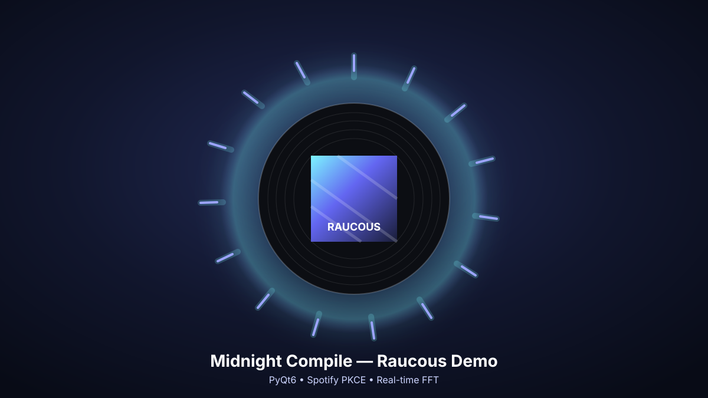
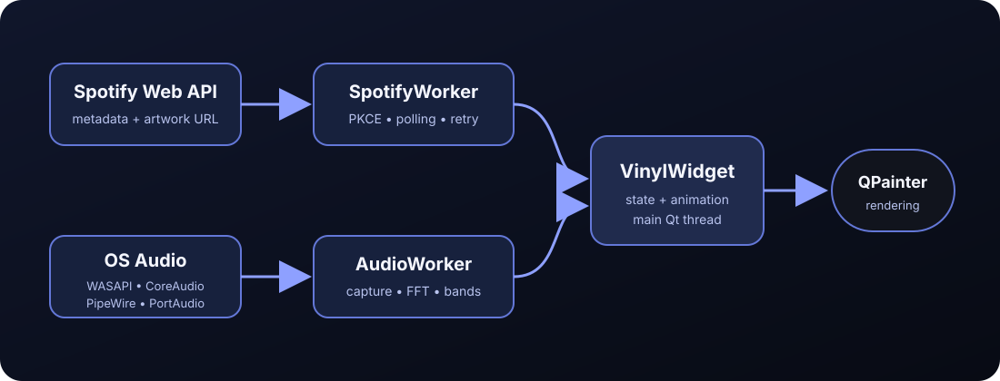

<div align="center">

# VinylPulse

**A cross-platform Spotify now-playing vinyl widget with a live circular audio visualizer.**

[](https://github.com/guptaoni891-ctrl/vinylpulse/actions/workflows/ci.yml)
[](https://www.python.org/)
[](#download-and-run)
[](LICENSE)



</div>

## Why this project stands out

VinylPulse is a packaged desktop application rather than a single-file visual
experiment. It demonstrates:

- secure Spotify OAuth using Authorization Code with PKCE
- native Windows WASAPI, macOS CoreAudio and Linux audio integration
- automatic Linux PipeWire-Pulse monitor capture with native fallbacks
- responsive PyQt6 UI with separate Spotify and audio workers
- real-time FFT processing with logarithmic frequency bands
- custom `QPainter` rendering and album-derived visualizer colours
- persisted preferences, structured logging and cooperative shutdown
- first-launch setup, installable packages, tests and release automation
- downloadable native builds generated by GitHub Actions

## Download and run

Open the repository's **Releases** page and download the package for your system:

| Platform | Release file | Launch |
|---|---|---|
| Windows 10/11 x64 | `VinylPulse-Windows-x64.zip` | Extract and run `VinylPulse.exe` |
| macOS Apple Silicon | `VinylPulse-macOS-Apple-Silicon.zip` | Extract and open `VinylPulse.app` |
| macOS Intel | `VinylPulse-macOS-Intel.zip` | Extract and open `VinylPulse.app` |
| Linux x64 | `VinylPulse-Linux-x64.tar.gz` | Extract and run `VinylPulse/VinylPulse` |

The release builds bundle Python and the Python dependencies. Users do not need
to install Python separately. Every release also includes `SHA256SUMS.txt` for
archive verification.

On first launch, VinylPulse asks for a Spotify **Client ID** or offers Demo Mode.
The Client ID is public application configuration, not a client secret.

## Demo mode

Reviewers can launch the full UI without Spotify credentials or audio setup.
Choose **Demo Mode** in the first-launch dialog, or run from source with:

```bash
vinylpulse --demo
```

Demo mode uses generated artwork and a deterministic synthetic spectrum. It does
not call Spotify or capture audio.

## Spotify setup

VinylPulse uses Spotipy's PKCE flow, so each user needs a Spotify application
**Client ID**. Under Spotify's current Development Mode rules, creating and using
a Web API app requires Spotify Premium. Demo Mode remains available without a
Spotify account or Client ID.

1. Create an application in the Spotify Developer Dashboard.
2. Add this redirect URI exactly:

   ```text
   http://127.0.0.1:8888/callback
   ```

3. Launch VinylPulse and paste the Client ID into the setup dialog.
4. Complete Spotify authorization in the browser.

Using a personal Client ID avoids sharing the five-user allowlist of someone
else's Development Mode app. A genuinely public no-setup Spotify integration
would require Spotify approval for extended quota mode.

The Client ID is saved in the user's platform-specific config directory. OAuth
tokens are saved in the user's cache directory and are never committed to Git.

Advanced users can still use environment variables:

```dotenv
SPOTIPY_CLIENT_ID=your_client_id
SPOTIPY_REDIRECT_URI=http://127.0.0.1:8888/callback
```

## Audio visualizer by platform

Spotify's Web API provides track metadata, not raw playback audio. VinylPulse
therefore captures audio locally and processes samples only in memory.

### Windows

VinylPulse uses the native WASAPI loopback exposed by the `SoundCard` backend.
It normally selects the active output automatically. If selection fails, run:

```powershell
vinylpulse --list-audio-devices
```

Then set `audio_device` to a speaker/loopback name substring. `Stereo Mix` is also
supported when the audio driver exposes it.

See [Windows setup and troubleshooting](docs/WINDOWS.md).

### macOS

The app uses CoreAudio inputs. macOS users must grant microphone/audio-input
permission. For desktop-output visualization, install a virtual loopback device
such as [BlackHole](https://github.com/ExistentialAudio/BlackHole), route the Mac
output through it, then select `BlackHole` as `audio_device`.

The Spotify artwork widget still works when no loopback device is installed; only
the live spectrum is unavailable.

See [macOS setup and troubleshooting](docs/MACOS.md).

### Linux

Automatic mode tries these backends in order:

1. PipeWire-Pulse monitor capture using `pactl` and `parec`
2. native PulseAudio capture through `SoundCard`
3. PortAudio input fallback through `sounddevice`

Arch Linux and Hyprland remain first-class: VinylPulse requests native Wayland
with an XWayland fallback and prefers the default PipeWire output monitor.

See [Linux setup](docs/LINUX.md) and the detailed
[Arch/Hyprland guide](docs/ARCH_HYPRLAND.md).

## Install from source

### Windows PowerShell

```powershell
py -m venv .venv
.venv\Scripts\Activate.ps1
python -m pip install --upgrade pip
python -m pip install -e ".[dev]"
vinylpulse --demo
```

Or run:

```powershell
.\scripts\setup_windows.ps1
```

### macOS

```bash
python3 -m venv .venv
source .venv/bin/activate
python -m pip install --upgrade pip
python -m pip install -e '.[dev]'
vinylpulse --demo
```

Or run:

```bash
./scripts/setup_macos.sh
```

### Linux

Install your distribution's Qt/PortAudio/PulseAudio runtime packages first, then:

```bash
python3 -m venv .venv
source .venv/bin/activate
python -m pip install --upgrade pip
python -m pip install -e '.[dev]'
vinylpulse --demo
```

Arch users can run:

```bash
./scripts/setup_arch.sh
```

## Audio configuration

List every backend's detected devices:

```bash
vinylpulse --list-audio-devices
```

Create and locate the JSON config:

```bash
vinylpulse --create-config
vinylpulse --print-config-path
```

Recommended portable configuration:

```json
{
  "audio_backend": "auto",
  "audio_device": null,
  "allow_microphone_fallback": false
}
```

Supported backend values:

- `auto`: choose the best backend for the current operating system
- `soundcard`: native WASAPI/CoreAudio/PulseAudio capture
- `pipewire`: Linux-only PipeWire-Pulse monitor capture
- `portaudio`: direct audio input through PortAudio

Prefer a device **name substring** rather than a numeric index because indices can
change when hardware is connected or removed. Downloaded builds can change these
values from **right-click → Audio settings…**; restart the app after saving.

## Controls

- **Left-drag:** move the widget
- **Right-click:** open the context menu
- **Open in Spotify:** open the current track or episode
- **Visualizer:** toggle the circular spectrum
- **Always on top:** toggle the window flag
- **Audio settings…:** choose a backend/device and save it without a terminal
- **Open configuration folder:** inspect or back up the generated JSON config
- **Escape:** quit

Window position and menu preferences persist between launches.

## Architecture



```text
Spotify Web API ──> SpotifyWorker ─────────────────────────┐
                                                           ├─> VinylWidget ─> QPainter
OS audio backend ─> AudioWorker ─> FFT/log bands ─────────┘
```

Spotify polling, artwork downloads and audio capture never block the GUI thread.
Qt signals carry immutable updates back to the main thread.

## CLI

```text
vinylpulse --demo
vinylpulse --list-audio-devices
vinylpulse --create-config
vinylpulse --print-config-path
vinylpulse --config ./config.json
vinylpulse --debug
```

The downloadable desktop builds are windowed applications. Use a source install
when you need CLI diagnostics.

## Development

```bash
python -m pip install -e '.[dev]'
ruff format src tests
ruff check src tests
mypy \
  src/vinylpulse/config.py \
  src/vinylpulse/pulse_audio.py \
  src/vinylpulse/soundcard_audio.py \
  src/vinylpulse/spectrum.py \
  src/vinylpulse/spotify_parser.py
pytest
python -m build
pyinstaller --noconfirm --clean vinylpulse.spec
```

Or run:

```bash
make check
```

## Automated native releases

Pushing a version tag such as `v1.1.0` runs
[`.github/workflows/release.yml`](.github/workflows/release.yml). GitHub builds
VinylPulse independently on Windows, Linux, Apple Silicon macOS and Intel macOS,
then uploads the platform-specific archives to that GitHub Release.

## Project structure

```text
src/vinylpulse/
├── app.py              # CLI, first-run setup and Qt bootstrap
├── audio_devices.py    # PortAudio discovery and selection
├── audio_worker.py     # cross-platform capture fallback orchestration
├── config.py           # validated JSON/environment configuration
├── dialogs.py          # in-app cross-platform audio settings
├── geometry.py         # pure visualizer geometry
├── logging_config.py   # rotating file and console logs
├── models.py           # cross-thread immutable models
├── pulse_audio.py      # Linux pactl discovery and parec commands
├── renderer.py         # record and visualizer rendering
├── settings.py         # persistent user preferences
├── soundcard_audio.py  # WASAPI/CoreAudio/PulseAudio device selection
├── spectrum.py         # FFT band calculation and smoothing
├── spotify_parser.py   # defensive Web API response parsing
├── spotify_worker.py   # PKCE, polling, retry and artwork fetching
└── widget.py           # window behaviour and UI coordination
```

## Privacy

- No Spotify client secret is stored.
- OAuth tokens remain in the local user cache.
- Album artwork is used only for display.
- Audio samples are processed in memory and never recorded or uploaded.
- VinylPulse is independent and is not affiliated with Spotify.

## Current limitations

- macOS desktop-output visualization requires a virtual audio loopback device.
- Unsigned Windows/macOS community builds may show an operating-system warning.
- Linux binaries depend on compatible system audio and graphics libraries; source
  installation is the most reliable fallback across distributions.

## License

Released under the [MIT License](LICENSE).
